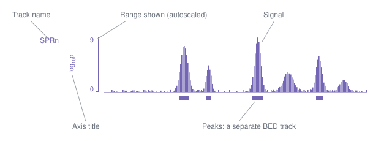

# About this browser

This page is written in `help/index.md`. Edit it to describe your project, your data and how to read the tracks. Everything here is plain [Markdown](https://commonmark.org/help/), turned into HTML when you run `npm run build`.

The demo tracks in the viewer are **synthetic**: random numbers shaped to look like a typical screen. Replace them with your own files.

## Reading a track

Each signal track has a name, a y-axis with its range, and a title for the units. Peaks or hits called from that signal sit directly underneath in the same color.

Click any track name in the viewer to jump to its section below. The [SPRn section](#track-demo_sprn) is an example.

## Getting around

| Do this | To |
| --- | --- |
| Scroll sideways (trackpad) or shift + scroll | Move along the chromosome |
| Alt / option + scroll over the tracks | Zoom in or out around the pointer |
| Drag across the tracks | Zoom to the region you selected |
| Double-click | Zoom out 3× around the pointer |
| Type in the position box | Jump to `chr7:55,100,001-55,150,000` or a chromosome name |
| Zoom slider, top right | Zoom from a whole chromosome down to single bases |
| ← / → keys | Move 10% left or right |

At the highest zoom the sequence track shows individual bases.

## Arranging tracks

- **Reorder:** drag a track name (or the dotted grip that appears on hover) up or down.
- **Hide:** hover a track name and click ×. Hidden tracks wait in the *Hidden tracks* tray under the viewer.
- **Bring back:** click a track in the tray to add it at the bottom, or drag it to the exact place you want.
- **Display options:** right-click a track name to change how it is drawn.

Your arrangement is remembered in this browser. **Reset view** in the toolbar restores the original layout and position.
